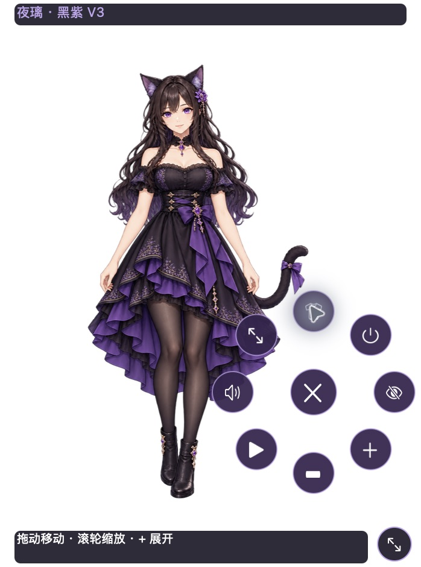

# 夜璃 · Nyra

黑紫成年猫耳桌宠，macOS 13+。**R3 的悬浮控制环、换装、缩放和全屏功能运行在本仓库的独立 App 中。** Codex 内置 Pets 仍按宿主提供的标准动画运行，图集不能自行增加这些按钮。

[下载可运行 macOS 版](https://github.com/loseyourself1978-blip/Nyra/releases/latest) · [R3 对照验收](R3_DELIVERY.md)



## 开始使用

1. 下载 Release 中的 **Nyra-R3-macOS.zip**，解压。
2. 双击 **夜璃 Nyra Preview.app**，或 **启动夜璃.command**。
3. 鼠标移近角色，点 **＋** 展开紫色控制环；点中央 **×** 收起。

| 操作 | 入口 |
|---|---|
| 移动 | 直接拖动角色 |
| 放大 / 缩小 | 控制环＋/−、滚轮、触控板捏合 |
| 连续拖拽缩放 | 右下角斜箭头圆柄，向右下拖放大、向左上拖缩小 |
| 一键换装 | 衣服图标，在黑紫与职场两套透明全身画稿间切换 |
| 全屏 | 对角箭头；按 Escape 或“回到桌面”返回 |
| 标准动作 | 播放图标，选择待机、工作、注视、庆祝、左右跑、挥手、跳跃、失落、等待、阅读、环顾 |
| 声音 | 喇叭图标，静音、音量、停止与可选系统语音试听 / 自有音频导入 |
| 隐藏 / 恢复 | 眼睛图标隐藏；菜单栏“◈ 夜璃”恢复 |
| 退出 | 电源图标或菜单栏“退出夜璃” |

透明区域按采样 alpha 点击穿透。隐藏后停止帧动画、悬停计时器和声音。位置、大小、服装与声音偏好保存在本机 `~/Library/Application Support/Nyra`，不会上传。

## 实际范围

- 默认服装：77 张原生 1024×1536 RGBA/sRGB 画稿，12 组动作 / 84 槽。保持原 P0 的20张唯一画稿 / 23槽。
- 职场服装：1 张透明全身中立图，**STATIC_OUTFIT_ONLY**，尚无动态换装动作。旧三张概念参考只在完整造型列表中保留，普通一键换装不再切到海报。
- 声音：两段自行合成的轻提示音。**AI 定制女性声线按用户要求暂缓**；本机中英女性系统语音仅手动试听、没有自动播报，也不称为专属声音。用户音频只保存在本机。
- TWOS：**NOT_CONNECTED**；状态演示标 SIMULATION，不读取业务资料，不修改 TWOS 或 Codex 主应用。
- 左右跑中段节奏和两处斜向注视沿用 R2 已记录的精修项。

这是原 App 的迭代，保留独立退出和单实例锁。Pets v2 图集及其生成资料也保存在仓库中。

## 构建与验证

在有 Xcode 命令行工具的 macOS 中运行：

```sh
python3 scripts/build.py
python3 scripts/verify.py
python3 scripts/package_r3.py
```

原生控件验收需要 macOS 图形登录会话。构建包含 arm64 与 x86_64；已在 Apple Silicon 实机测试，未声明 Intel 实机验证。当前为 ad-hoc 签名，未 Apple 公证。

`Nyra-R3-Complete.zip` 包含可公开的完整源码、原始参考、运行素材、提示词、图集、原始生成稿和验收材料。个人账户回执、本地偏好、自有音频、构建缓存和历史 dist 包不公开。

R1/R2 文档与素材是历史记录；当前状态以 R3_DELIVERY.md 和 production-r3/reports 为准。
