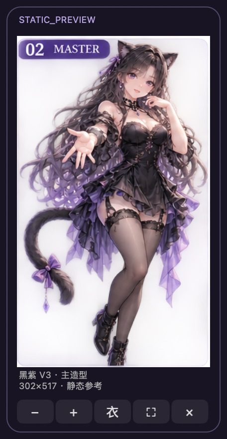

# 夜璃 · Nyra

V3 黑紫成年猫耳角色的**独立 macOS 静态概念预览**。

当前阶段：`ASSET_AUDIT_AND_STANDALONE_PREVIEW`。能够启动、拖动、缩放、一键切换服装参考、全屏展示、隐藏和完全退出。不是最终动画桌宠、Live2D、3D 模型或已创建的 ChatGPT Pet。



## 直接启动

1. 保持整个文件夹完整，双击 **夜璃 Nyra Preview.app**，或双击 **启动夜璃.command**。
2. 浮动卡片中的 `− / +` 调整大小，`衣` 循环切换黑紫主造型、职场参考、晚礼服参考，`⛶` 进入全屏展示，`×` 隐藏。
3. 拖住图片或卡片空白处移动；图片上滚轮或触控板缩放也可调整尺寸。
4. 菜单栏 **◈ 夜璃** 提供显示/隐藏、复位位置、服装选择、整窗点击穿透和退出。
5. 全屏展示页可切换服装，点击“全屏 / 返回”退出全屏，或点击“回到桌面”恢复浮动卡片。
6. **退出夜璃** 会结束独立进程。隐藏后可从菜单栏恢复，也可再次双击 App 恢复。

该构建为 Apple Silicon / Intel 通用二进制，部署目标 macOS 13+；实际运行验证设备为本次 Apple Silicon Mac。仅本地 ad-hoc 签名，未做 Apple 开发者签名或公证。跨机器下载后的系统信任提示不属于本机运行验证范围。

## 素材与换装的真实状态

| 项目 | 实际状态 |
|---|---|
| 3 张综合概念图 | 已保留原件、测量、校验哈希 |
| 8 张图板裁片 | 与主图对应裁区逐像素一致；参考用途 |
| V3 来源参考 | 1536×512 RGB；已保留 |
| 黑紫主造型预览 | 原样使用 302×517 裁片，含烘焙背景/标题 |
| 一键换装 | 切换现有服装**概念参考**；职场/礼服各 86×212，半身、未对齐 |
| 透明运行素材 | **0 项合格** |
| 4 个真实动画 | **缺失**，没有用缩放/摇摆冒充 |
| 专属声音 | **NOT_PRODUCED**，没有播放系统 TTS |
| TWOS 实时事件 | **未接入 / BLOCKED** |
| 状态演示 | 手动文字示例，始终标 `SIMULATION`；不解析或重放真实任务 |
| ChatGPT Pets 创建/选中 | **未执行**；缺合格 v2 动作图集 |
| Owner Acceptance | **未声明** |

全屏仅扩大显示范围，界面持续标出源像素和放大倍数，不会提高素材原始清晰度。主造型以 V3 黑紫为准；换装裁片是用户追加换装要求下的可选参考，不替换母版身份。

当前浮动窗口是**可见不透明概念卡片**，因为现有图片带底。卡片外没有隐形命中区域；整窗穿透可通过菜单显式开启，并从菜单恢复。人物轮廓级 alpha 命中要等合格透明素材后实现、实测。

## 资料

- [实际素材审计](docs/ASSET_AUDIT.md)：实际尺寸、alpha、更正与可视检查。
- [最小补图清单](docs/MINIMUM_ASSETS.md)：四种动作、换装、尺寸、透明度、锚点、分层、Pets v2 要求。
- [交付与验证报告](docs/DELIVERY_REPORT.md)：实际验证、未验证项、状态边界。
- [权限与来源](docs/SCOPE_AND_AUTHORIZATION.md)：本次请求与附件规范的区别。
- `reports/asset-audit.json`、`assets/outfits.json`：逐文件哈希、裁区、实际像素、分类。
- `source-handoff/`：原始工程 ZIP 与完整解压资料，原件未改。
- `Sources/`、`scripts/`：全部实现、离线构建和校验代码。

## 离线重建

需要本机已有 Xcode Command Line Tools。预览 App 无第三方运行依赖，也不联网。

```bash
python3 scripts/build.py
python3 scripts/verify.py
```

审计/重新裁出参考图需要本机 Python 的 Pillow；本次使用已有安装，没有下载依赖：

```bash
python3 scripts/audit_assets.py
```

若改了 `assets/`，请重新运行构建，App 内使用打包后的资源。所有服装条目必须留在 `STATIC_CONCEPT_REFERENCE`；当前程序拒绝把条目标成运行时就绪。

配置仅写入本文件夹内 `.local/`，构建中间文件仅写入 `.build/`，二者不上传仓库。没有开机自启、麦克风、录屏、辅助功能、全局键盘/鼠标监听、模型服务、语音或 TWOS 数据连接。

GitHub 交付目标为**新建私有仓库**；无公开站点、公开 Release 或 Tag。以 [上传回执](reports/github-upload.json) 中实际核验结果为准。

完整打包文件在 `dist/Nyra-R1.zip`，含 App、源码、报告和原始交接资料；不含构建缓存、Git 内部数据或本地偏好。
