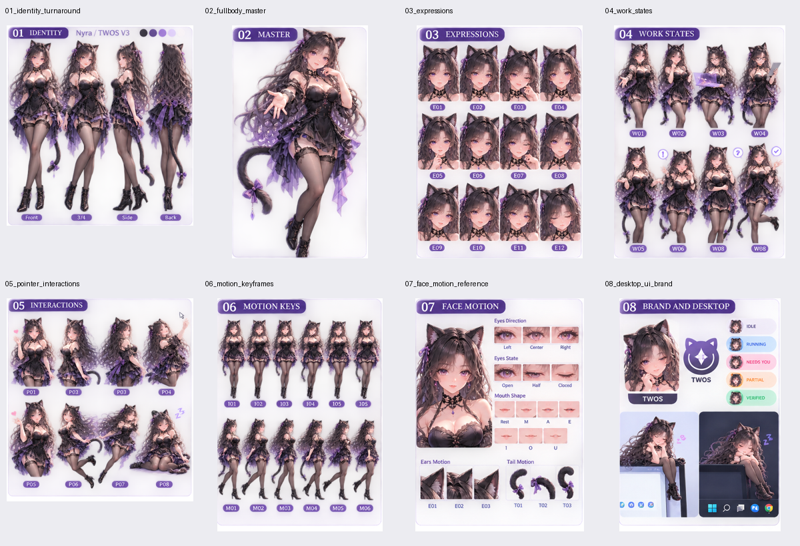

# V3 实际素材审计

审计日期：2026-10-23（Asia/Shanghai）。方法：Pillow 实际解码、alpha 直方图、SHA-256、图板像素比对及人工可视检查。机器可读完整结果见 `reports/asset-audit.json`。

## 资产分类

| 类别 | 数量 | 分类与用途 |
|---|---:|---|
| 综合设定图 | 3 | 可展示参考；主白底图为实现参照，A/B 夜景图非身份权威 |
| 主图裁片 | 8 | 可展示参考；并非 8 张独立高清透明画稿 |
| 原始选定 V3 来源 | 1 | 可展示参考；1536×512 RGB |
| 合格透明运行姿态 / 动作帧 | 0 | MISSING |
| PSD 分层、骨骼、Live2D、3D | 0 | NOT_SUPPLIED |
| 原创音频或音色模型 | 0 | NOT_PRODUCED |

26 项原始文件哈希均与原包 `MANIFEST.sha256` 相符。3 张综合图与 8 张裁片哈希均与原 `asset_catalog.json` 相符；8 张裁片均与主图所声明裁区逐像素一致。完整原 ZIP 和解压文件均保留。

## 实际像素和 alpha

| 文件 | 实际宽×高 | 解码 | alpha 范围 | 全透明像素 |
|---|---|---|---|---:|
| V3_PRIMARY_COMPOSITE | 1536×1024 | RGBA | 0–252 | 696 |
| V3_ALTERNATE_CONCEPT_A | 1536×1024 | RGBA | 1–253 | 0 |
| V3_ALTERNATE_CONCEPT_B | 1536×1024 | RGBA | 6–251 | 0 |
| 01_identity_turnaround | 481×517 | RGBA | 0–252 | 422 |
| 02_fullbody_master | 302×517 | RGBA | 0–252 | 1 |
| 03_expressions | 368×517 | RGBA | 2–252 | 0 |
| 04_work_states | 379×517 | RGBA | 1–252 | 0 |
| 05_pointer_interactions | 462×503 | RGBA | 0–252 | 269 |
| 06_motion_keyframes | 357×503 | RGBA | 2–252 | 0 |
| 07_face_motion_reference | 363×503 | RGBA | 1–252 | 0 |
| 08_desktop_ui_brand | 348×503 | RGBA | 1–252 | 0 |
| V3_SELECTED_REFERENCE | 1536×512 | RGB | 转 RGBA 后全 255 | 0 |

**对交接说明的更正：** `GENERATED_ASSET_RECEIPT.md` 称生成图为 RGB；实际 11 张生成 PNG 是 RGBA。它们没有可用的人物轮廓透明底：背景、色块、标题、标签仍在画面中，alpha 大量接近但低于 255，零值极少或没有。这是“有 alpha 通道但不是合格透明运行素材”，不能用 `nonopaque_fraction=1` 冒充抠图通过。

## 人工可视检查

- 主图与来源参考具有黑紫、猫耳、深色卷发、紫眼、紫晶发饰等 V3 识别特征。主图中的小图有脸部和姿态差异，不视为已经过身份连续性验收。
- 01 的四视图是 481×517 整板，每个人物只占其中一部分，含标题、底纹、方向标签；不是四张高清独立角色。
- 02 主造型可做小尺寸静态预览，但原生只有 302×517，顶部标题烘焙，足部接近边缘、留白不足；不作为正式透明主立绘。
- 03 的表情是小头部图板，标签有重复；未分离五官层，不能当作口型/眨眼图层。
- 04 工作状态标签有跳号/重复，含道具与浮动符号。不能按标签自动推断成功或业务状态。
- 05 交互姿态缺乏运行时对齐，含浮动心形/睡眠符号；头发/尾巴与相邻单元边界紧，未确认可无损分组。
- 06 有连续姿态的设计意图，但每个小人分辨率低，缺干净轮廓 alpha、统一运行锚点和实播验证；没有登记为无缝动作。
- 07 五官图与主体混在同板，无完整遮挡补画层，不能直接组成 Live2D 或真实口型绑定。
- 08 混合品牌/UI/桌面示意，还含系统界面元素；不作为桌宠主体贴图。
- 两张夜景备选图包含不同服装、Q版、场景、错误命名/模型/语音宣称。仅作参考，不进入正式状态枚举、产品能力或母版判定。
- 手指、服饰覆盖、尾部连续性需要在下一轮独立高清帧上重新验收；本次不为低分辨率图板给解剖或身份一致性 PASS。

## 预览实际使用

1. 黑紫主造型：原样复制 `02_fullbody_master.png`，不放大重采样成伪高清，不去标题，不伪造透明度。
2. 职场：从权威来源参考裁出 `[1118,41,1204,253]`，86×212。
3. 晚礼服：从同一来源裁出 `[1207,41,1293,253]`，86×212。

裁区坐标为原图左上角坐标系的 `[left, top, right, bottom]`，右/下边界不包含。两张换装参考为半身低分辨率图，不是运行服装套件；均无统一 foot anchor，manifest 的 `anchor=null`、`runtimeReady=false`。所有来源/输出哈希记录在 `assets/outfits.json`。

没有重绘、生成新人物或动作、伪造 alpha、自动绑定或以整体摇摆模拟动画。全屏展示仅改变观看尺寸，保持长宽比并显示放大提示。

