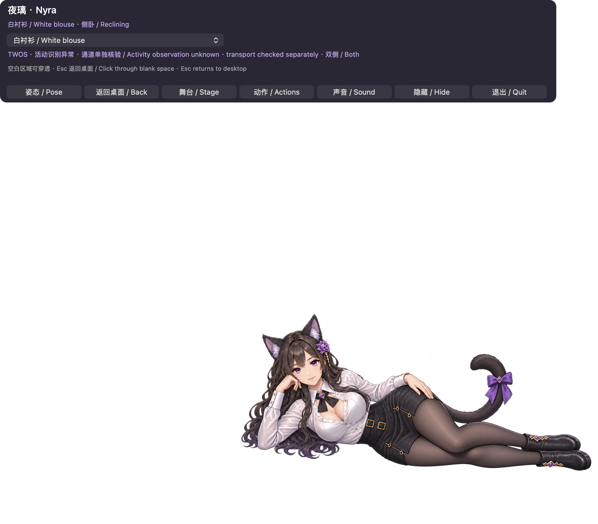
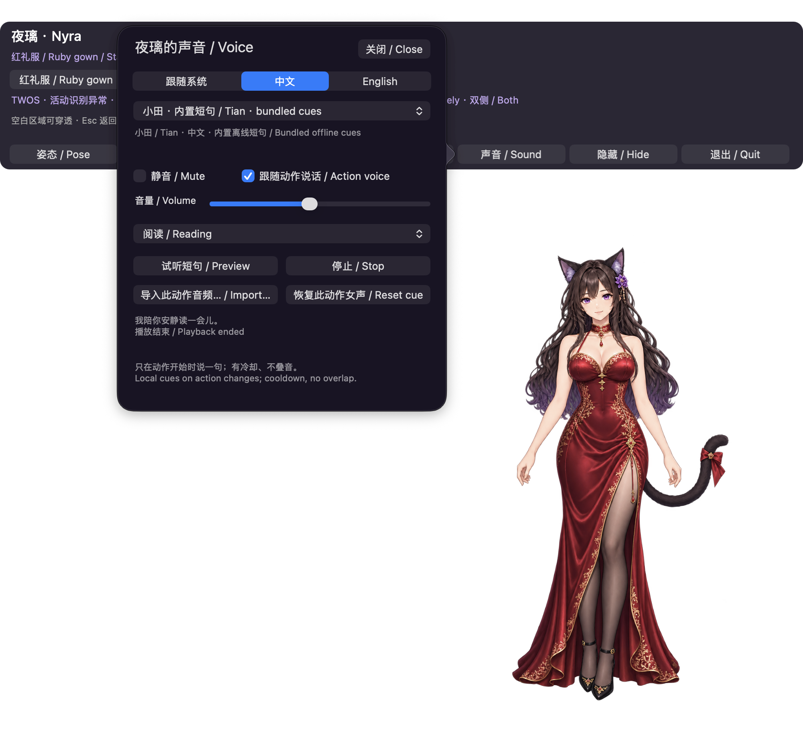
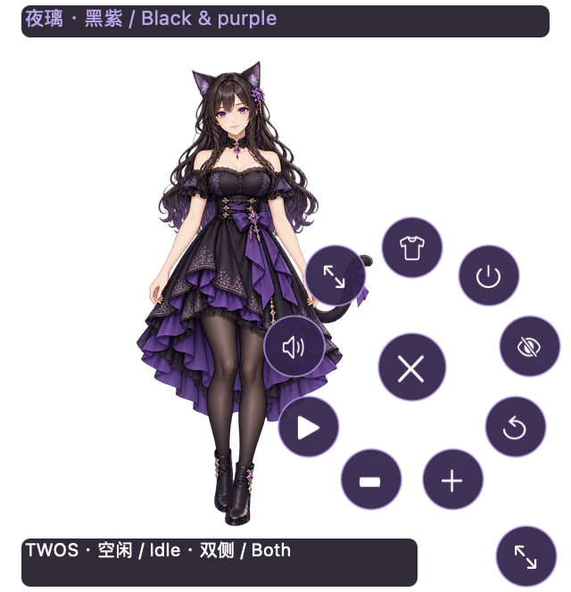
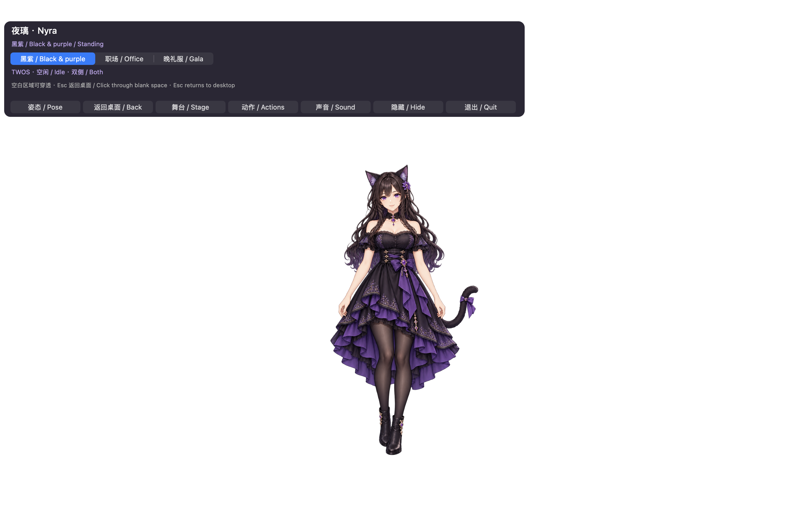

# 11 月 5 日候选：五套服装与动作语音

以下来自 Developer ID 签名 TWOS 1.0.6／101.54 内置 Nyra 1.0.5／105 的真实窗口。显示实际换装和可关闭声音面板，不代表完整流程或 Owner 验收。网页当时等待工程登录，因此活动明确标为观察未知。PNG 透明区域在某些查看器中呈黑色，不是舞台填充。本次增量未录新视频；下方旧媒体保留各自版本标识。

---

# R4 真实界面

匹配最终候选的截图随发行回执标识。本次控件补丁没有新增视频门槛；旧录像不展示 R4 控件。当前媒体只使用无私人内容的工程会话／窗口。

[Historical R3/R2/R1 media](MEDIA_HISTORICAL_R3.zh-CN.md) · [R4 guide](SIMPLIFIED_UX_R4.zh-CN.md)

以下来自 Nyra 1.0.3 / 103 的真实隔离候选窗口，源提交 `18abd9f043b94cc7c384e6f8c1f2504683505384`。透明区域的截图查看器底色不代表舞台填充了黑色。

